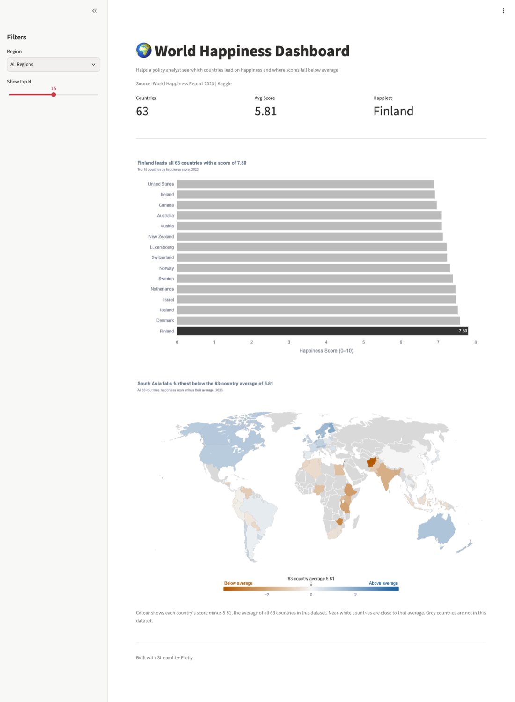

# dataviz-exercises-ivan-logutov

Weekly class exercises for **DSC02 Data Visualization 120C** (Winter 2026/27, Dr. Dina Deifallah) by Ivan Logutov.


Class material: [dina-deifallah/data-viz-class-material-w2026](https://github.com/dina-deifallah/data-viz-class-material-w2026)

## Structure

```
weekXX/
  lectureXX_exercise.ipynb   ← Part 1 (Plotly), lectures 1–8
  lectureXX_exercise.py      ← Part 2 (Streamlit), lectures 9–14
```

## Streamlit apps

| Lecture | Live app | Code |
|---|---|---|
| 09 | [World Happiness dashboard](https://ivan-logutov-happiness.streamlit.app) | [week09/lecture09_exercise.py](week09/lecture09_exercise.py) |

Free Streamlit apps go to sleep when nobody uses them. If you see a wake-up button, click it and wait for the app to start.


